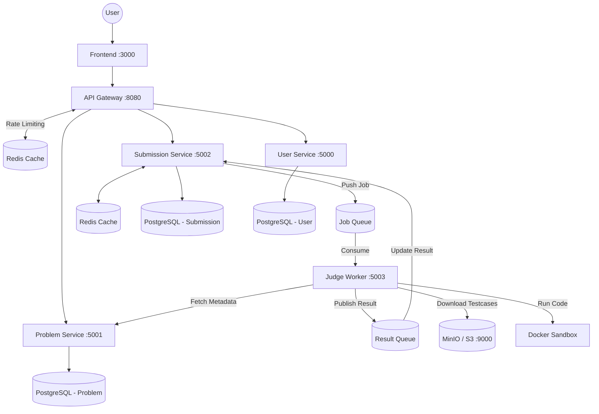

# Online Judge

[](https://github.com/hungdn1701/microservices-assignment-starter/stargazers)
[](https://github.com/hungdn1701/microservices-assignment-starter/network/members)
[](LICENSE)

> Brief description of the business process being automated and the service-oriented solution.

> **New to this repo?** See [`GETTING_STARTED.md`](GETTING_STARTED.md) for setup instructions and workflow guide.

---

## Team Members

| Name | Student ID | Role | Contribution |
|------|------------|------|-------------|
|  Nguyễn Công Duẩn|B22DCCN119|Leader|Api Gateway + Submission Service + Observability|
|Nguyễn Quốc Khánh|B21DCCN456|Member|Problem Service + Frontend|
|Nguyễn Ngọc Sơn|B22DCCN695|Member|Judge Service + User Service + Discovery|


---

## Business Process

*(Summarize the business process being automated — domain, actors, scope)*

Hệ thống tự động hóa quy trình **nộp bài và chấm điểm lập trình** cho sinh viên và người luyện thuật toán:


- **Domain:** Online Code Judging
- **Actors:** Sinh viên / Người luyện thuật toán / Người thi
- **Scope**: Xem đề bài → Soạn thảo code → Nộp bài → Hệ thống chấm tự động → Nhận kết quả

---

## Architecture




### Bảng Thành Phần

| Component | Trách nhiệm | Tech Stack | Port |
|-----------|-------------|------------|------|
| **Frontend** | Giao diện soạn thảo (Monaco Editor), xem bài, lịch sử nộp | React 18 + TypeScript + Vite + Tailwind CSS | 3000 |
| **API Gateway** | Định tuyến, xác thực JWT, Rate Limiting | Spring Boot + Spring Cloud Gateway | 8080 |
| **Service Discovery** | Đăng ký & khám phá dịch vụ | Spring Boot + Eureka Server | 8761 |
| **User Service** | Quản lý tài khoản, cấp phát token | Java / Spring Boot | 5000 |
| **Problem Service** | Quản lý đề bài, testcases, metadata | Java / Spring Boot | 5001 |
| **Submission Service** | Tiếp nhận bài nộp, lắng nghe Result Queue | Java / Spring Boot | 5002 |
| **Judge Service** | Worker chấm bài, quản lý Docker Sandbox | Java / Spring Boot | 5003 |
| **RabbitMQ** | Message Broker — 2 queues: Jobs & Results | RabbitMQ 3 | 5672 / 15672 |
| **Redis** | Cache trạng thái bài nộp (Polling optimization) | Redis 7 | 6379 |
| **MinIO** | Object Storage lưu trữ file testcases (.txt) | MinIO | 9000 / 9001 |
| **PostgreSQL** | Database riêng biệt cho từng service | PostgreSQL 16 | 5433–5435 |
| **Prometheus** | Thu thập metrics hệ thống | Prometheus | 9090 |
| **Grafana** | Dashboard giám sát & cảnh báo | Grafana | 3001 |
| **Loki + Promtail** | Tập trung logs từ tất cả container | Grafana Loki | 3100 |

> Tài liệu đầy đủ: [`docs/architecture.md`](mid-project-119695456/docs/architecture.md) · [`docs/analysis-and-design.md`](mid-project-119695456/docs/analysis-and-design.md)


---


## Cài Đặt & Chạy (Getting Started)

### Yêu cầu
- Docker Desktop >= 24.x
- Docker Compose >= 2.x

### Khởi động

```bash
# 1. Clone repository
git clone <your-repo-url>
cd mid-project-119695456

# 2. Cấu hình environment
cp .env.example .env
# Chỉnh sửa .env với các giá trị phù hợp

# 3. Build sandbox image trước (bắt buộc cho Judge Service)
bash build-sandbox.sh

# 4. Khởi động toàn bộ hệ thống
docker compose up --build
```

### Kiểm tra hệ thống

```bash
# Health check các service
curl http://localhost:8080/health          # API Gateway
curl http://localhost:5000/health          # User Service
curl http://localhost:5001/health          # Problem Service
curl http://localhost:5002/health          # Submission Service
curl http://localhost:5003/health          # Judge Service

# Truy cập giao diện
# Frontend:          http://localhost:3000
# Eureka Dashboard:  http://localhost:8761
# RabbitMQ UI:       http://localhost:15672
# MinIO Console:     http://localhost:9001
# Grafana:           http://localhost:3001
```

---

## API Documentation

| Service | OpenAPI Spec |
|---------|-------------|
| Gateway | [`docs/api-specs/gateway.yaml`](mid-project-119695456/docs/api-specs/gateway.yaml) |
| Problem Service | [`docs/api-specs/problem-service.yaml`](mid-project-119695456/docs/api-specs/problem-service.yaml) |
| Submission Service | [`docs/api-specs/submission-service.yaml`](mid-project-119695456/docs/api-specs/submission-service.yaml) |
| User Service | [`docs/api-specs/user-service.yaml`](mid-project-119695456/docs/api-specs/user-service.yaml) |


## Cấu Trúc Thư Mục

```
mid-project-119695456/
├── docker-compose.yml
├── .env.example
├── build-sandbox.sh          # Build Docker sandbox image
├── discovery/                # Eureka Server (Spring Boot)
├── gateway/                  # API Gateway (Spring Cloud Gateway)
├── frontend/                 # React + TypeScript UI
├── services/
│   ├── user-service/         # Xác thực & quản lý người dùng
│   ├── problem-service/      # Quản lý đề bài & testcases
│   ├── submission-service/   # Tiếp nhận bài nộp & kết quả
│   └── judge-service/        # Worker chấm bài + Docker Sandbox
├── observability/
│   ├── prometheus.yml
│   ├── loki-config.yaml
│   ├── promtail-config.yaml
│   └── grafana/
└── docs/
    ├── architecture.md
    ├── analysis-and-design.md
    └── api-specs/
```

---

## Giám Sát (Observability)

| Tool | URL | Mục đích |
|------|-----|----------|
| **Grafana** | `http://localhost:3001` | Dashboard metrics & logs |
| **Prometheus** | `http://localhost:9090` | Thu thập metrics từ services |
| **Loki** | `http://localhost:3100` | Tập trung logs container |
| **RabbitMQ UI** | `http://localhost:15672` | Theo dõi Job Queue & Result Queue |

---

## License

[MIT License](LICENSE)
