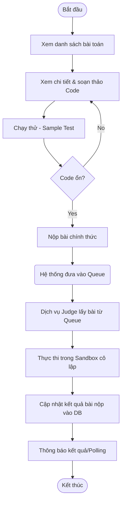
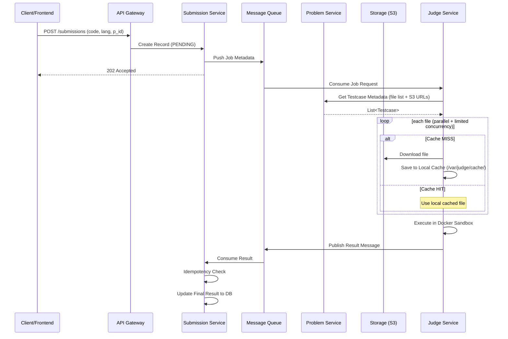
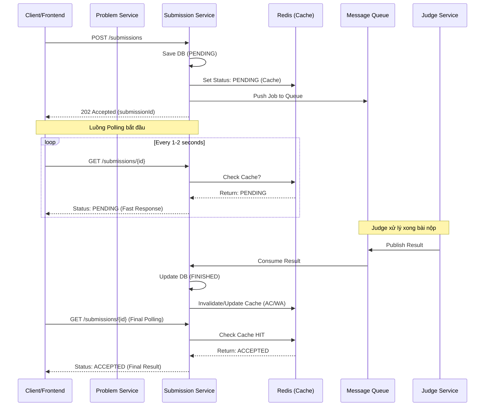
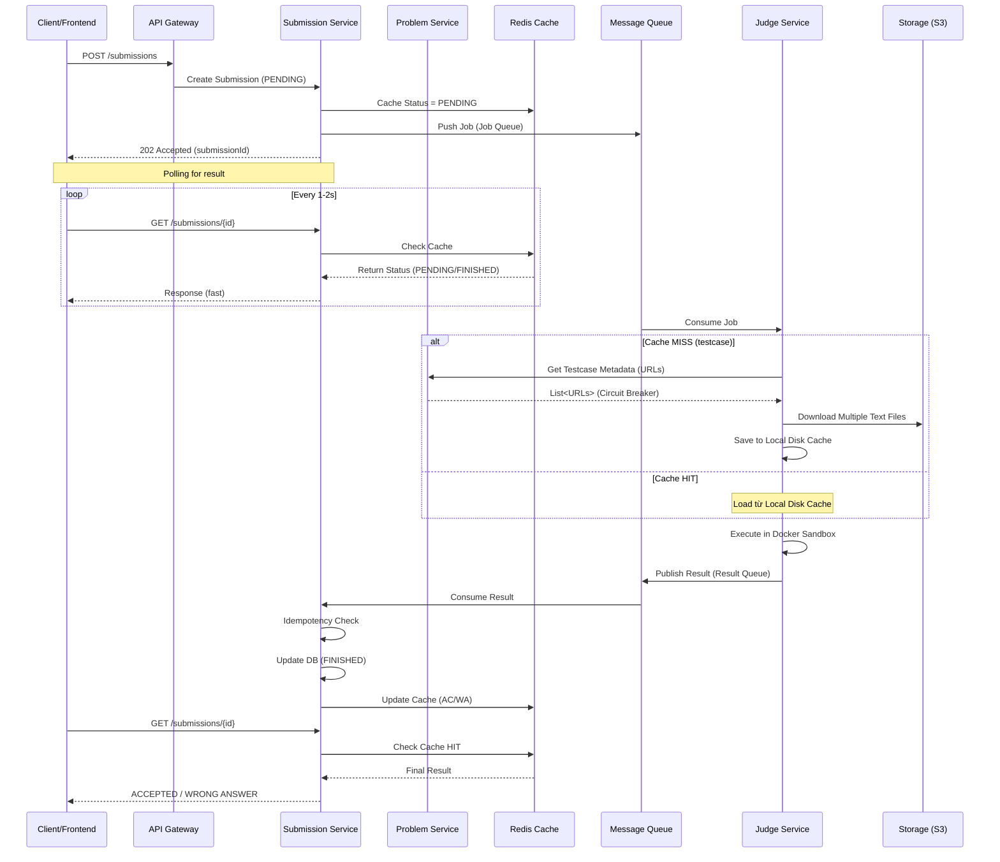
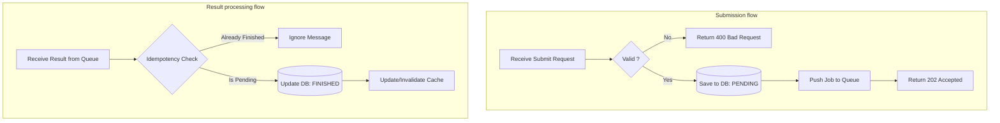
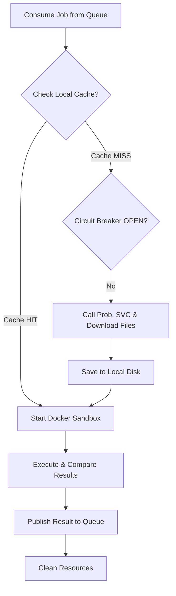

# Analysis and Design — Business Process Automation Solution

> **Goal**: Phân tích quy trình nộp bài lập trình và thiết kế giải pháp hướng dịch vụ (SOA/Microservices).
> Scope: Tập trung vào 01 feature chính là "Submission & Judging"

---

## Part 1 — Analysis Preparation

### 1.1 Business Process Definition
- **Domain**: Online Code Judging
- **Business Process**: Nộp mã nguồn và chấm điểm tự động 
- **Actors**: Người học (User/Student)
- **Scope**: Từ khi người dùng xem đề bài, nộp bài đến khi kết quả được lưu trữ và hiển thị.

**Sơ đồ quy trình nghiệp vụ (Business Process Flowchart):**



### 1.2 Existing Automation Systems
| System Name | Type | Current Role | Interaction Method |
|-------------|------|--------------|-------------------|
| None | - | Quy trình hiện tại đang được thực hiện thủ công | - |

### 1.3 Non-Functional Requirements
| Requirement    | Description |
|----------------|-------------|
| Performance    | Thời gian thực thi code < 2 giây/testcase. Tối ưu nạp testcase qua Local Disk Cache và Parallel Downloading (.txt). |
| Security       | Thực thi code trong môi trường sandbox (isolation), hạn chế truy cập CPU, memory, file system và network. |
| Scalability    | Judge Worker có thể scale horizontally dựa trên độ dài message queue. |
| Availability   | Submission Service luôn phục vụ request nộp bài dù Judge bận. |
| Reliability    | Sử dụng Message Queue trong kiến trúc bất đồng bộ và Idempotency Check để đảm bảo dữ liệu không bị mất và được xử lý chính xác. |


---

## Part 2 — REST/Microservices Modeling

### 2.1 & 2.2 Decompose Business Process & Filter Unsuitable Actions
| # | Action | Actor | Description | Suitable? |
|---|--------|-------|-------------|-----------|
| 1 | Xem danh sách bài toán | User | Lấy danh mục bài tập từ cơ sở dữ liệu | ✅ |
| 2 | Xem chi tiết bài toán | User | Lấy yêu cầu, giới hạn và testcase mẫu | ✅ |
| 3 | Chạy thử mã nguồn (Run) | User | Chấm nhanh với input tùy chỉnh/mẫu | ✅ |
| 4 | Khởi tạo bài nộp (Submit)| User | Lưu code ban đầu với status PENDING | ✅ |
| 5 | Chấm bài ngầm (async) | Judge | Thực thi code qua nhiều testcase ngầm | ✅ |
| 6 | Ghi nhận kết quả | Judge | Cập nhật status từ PENDING sang kết quả cuối cùng | ✅ |
| 7 | Tra cứu kết quả (Polling)| User | Client theo dõi trạng thái qua Polling API | ✅ |

### 2.3 Entity Service Candidates
| Entity | Service Candidate | Agnostic Actions |
|--------|-------------------|------------------|
| User | User Service | CreateUser, GetUserProfile, UpdateUserProfile, GetUserStatistics, GetUserSubmissions, AuthenticateUser |
| Problem | Problem Service | CreateProblem, GetProblem, GetProblemList, UpdateProblem, SearchProblems, GetProblemDetail, AddTestCases, GetTestCases |
| Submission | Submission Service | CreateSubmission, GetSubmission, GetSubmissionList, GetSubmissionDetail, GetSubmissionResult, GetUserSubmissionsByProblem, RejudgeSubmission |

### 2.4 Task Service Candidate
| Non-agnostic Action | Task Service Candidate |
|---------------------|------------------------|
| Validate → Save Submission → Publish to Message Queue | Submission Service |
| Consume Verdict from Queue → Update Status | Submission Service |

### 2.5 Identify Resources
| Entity / Process | Resource URI |
|------------------|--------------|
| Bài toán | `/problems` |
| Bài nộp | `/submissions` |
| Quản lý bộ test | `/api/problems/{id}/testcases` |


### 2.6 Associate Capabilities with Resources and Methods
| Service Candidate | Capability | Resource | HTTP Method |
|-------------------|------------|----------|-------------|
| Problem Service | View List | `/problems` | GET |
| Problem Service | View Detail | `/problems/{id}` | GET |
| Submission Service| Submit Code | `/submissions` | POST |
| Submission Service| Get Status | `/submissions/{id}` | GET |

### 2.7 Utility Service & Microservice Candidates
| Candidate | Type | Justification |
|-----------|------|---------------|
| Judge Service | Microservice | Xử lý logic chấm điểm biệt lập, đòi hỏi tính cô lập tài nguyên (Sandbox) và hiệu suất thực thi cao. |
| Gateway | Utility | Quản lý định tuyến, xác thực JWT và Rate Limiting. |
| Message Broker | Utility | (RabbitMQ) Đảm bảo tính bất đồng bộ giữa các dịch vụ. |
| Storage | Utility | (Minio/S3) Lưu trữ tập trung các bộ file testcases (.txt). |

### 2.8 Service Composition Candidates
**Sơ đồ xử lý của Judge SVC:**



**Sơ đồ Tương tác (Tối ưu hóa với Polling & Redis Cache):**


**Sơ đồ tổng quát:**



---

## Part 3 — Service-Oriented Design

### 3.1 Uniform Contract Design (API Specifications)

**A. Problem Service (Entity Service - Port 5001)**
| Endpoint | Method | Media Type | Response Codes |
|----------|--------|------------|----------------|
| `/api/problems` | GET | application/json | 200 (Success) |
| `/api/problems/{id}` | GET | application/json | 200 (Success), 404 (Not Found) |
| `/api/problems/{id}/testcases` | GET | application/json | 200 (Internal Only), 403 (Forbidden) |

**B. Submission Service (Entity Service - Port 5002)**
| Endpoint | Method | Media Type | Response Codes |
|----------|--------|------------|----------------|
| `/api/submissions` | POST | application/json | 202 (Accepted), 400 (Bad Request) |
| `/api/submissions/{id}` | GET | application/json | 200 (Polling), 404 (Not Found) |
| `/api/submissions/internal/{id}` | PATCH | application/json | 200 (Success), 401 (Unauthorized) |

### 3.2 Service Logic Design

**1. Submission Service Logic:**
Sử dụng hai luồng xử lý bất đồng bộ riêng biệt (submission flow và result processing flow) để tách biệt việc tiếp nhận bài và cập nhật kết quả.


**2. Judge Service Logic (Worker):**



---

## Part 4 — Data Model

Mô hình dữ liệu được thiết kế theo nguyên tắc **Database per Service** để đảm bảo tính độc lập.

### 4.1 User Service — Data Model
Quản lý định danh và phân quyền người dùng trong hệ thống.

```text
┌──────────────────────────────┐
│             User             │
├──────────────────────────────┤
│ id: UUID (PK)                │
│ username: VARCHAR(100)       │
│ email: VARCHAR(255)          │
│ password_hash: VARCHAR(255)  │
│ role: ENUM (ADMIN, STUDENT)  │
│ created_at: TIMESTAMP        │
│ updated_at: TIMESTAMP        │
└──────────────────────────────┘
```

### 4.2 Problem Service — Data Model
Quản lý nội dung bài tập và các bộ kiểm thử tương ứng (1 đề bài có nhiều TestCases).

```text
┌──────────────────────────────────────────────┐       ┌──────────────────────────────────────────────┐
│                   Problem                    │       │                  TestCase                    │
├──────────────────────────────────────────────┤       ├──────────────────────────────────────────────┤
│ id             : UUID (PK)                   │       │ id             : UUID (PK)                   │ 
│ title          : VARCHAR(255)                │       │ problem_id     : UUID (FK)                   │
│ description    : TEXT                        │──────○│ input_key      : VARCHAR(512)                │
│ time_limit     : INT (ms)                    │ (1-n) │ output_key     : VARCHAR(512)                │
│ memory_limit   : INT (KB)                    │       │ created_at     : TIMESTAMP                   │
│ difficulty     : ENUM                        │       └──────────────────────────────────────────────┘
│                  (EASY, MEDIUM, HARD)        │
│ created_at     : TIMESTAMP                   │
└──────────────────────────────────────────────┘
```

### 4.3 Submission Service — Data Model
Lưu trữ mã nguồn và kết quả phản hồi từ Judge Service.

```text
┌──────────────────────────────────────────────┐
│                 Submission                   │
├──────────────────────────────────────────────┤
│ id             : UUID (PK)                   │
│ problem_id     : UUID (FK)                   │
│ user_id        : UUID (FK)                   │
│ code           : TEXT                        │
│ language       : VARCHAR(50)                 │
│ status         : ENUM                        │
│                  (PENDING, RUNNING, FINISHED)│
│ verdict        : ENUM                        │
│                (AC, WA, TLE, MLE, RTE, CESE) │
│ time_used      : INT (ms)                    │
│ memory_used    : INT (KB)                    │
│ error_details  : TEXT                        │
│ submitted_at   : TIMESTAMP                   │
│ finished_at    : TIMESTAMP                   │
└──────────────────────────────────────────────┘
```