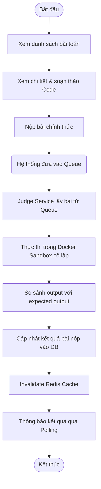
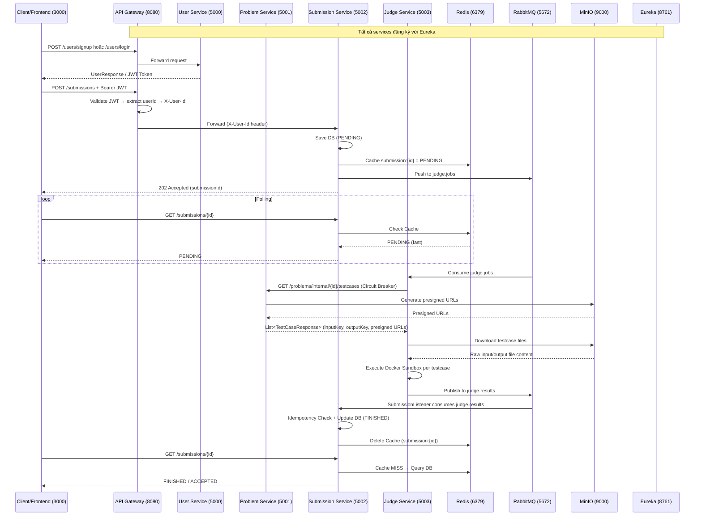
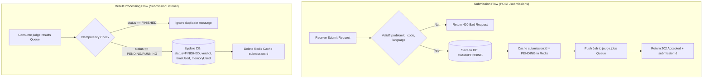
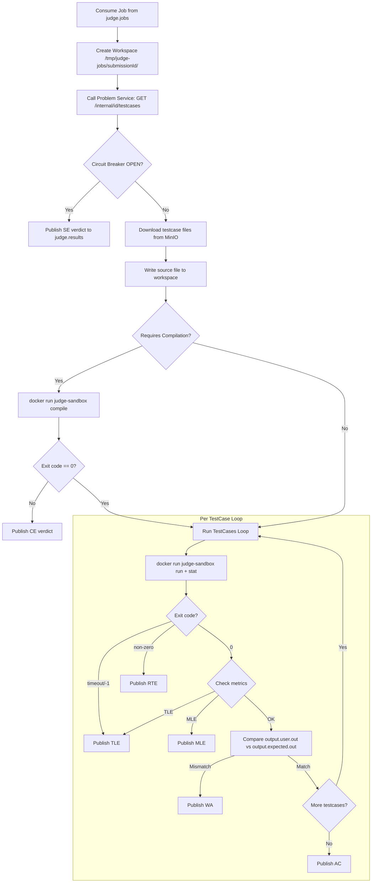

# Analysis and Design — Business Process Automation Solution

> **Goal**: Phân tích quy trình nộp bài lập trình và thiết kế giải pháp hướng dịch vụ (SOA/Microservices).
> Scope: Tập trung vào 01 feature chính là "Submission & Judging"

---

## Part 1 — Analysis Preparation

### 1.1 Business Process Definition
- **Domain**: Online Code Judging
- **Business Process**: Nộp mã nguồn và chấm điểm tự động 
- **Actors**: Sinh viên / Người luyện thuật toán / Người thi
- **Scope**: Xem đề bài → Soạn thảo code → Nộp bài → Hệ thống chấm tự động → Nhận kết quả


**Sơ đồ quy trình nghiệp vụ (Business Process Flowchart):**



### 1.2 Existing Automation Systems
| System Name | Type | Current Role | Interaction Method |
|-------------|------|--------------|-------------------|
| None | - | Quy trình hiện tại đang được thực hiện thủ công | - |

### 1.3 Non-Functional Requirements
| Requirement    | Description |
|----------------|-------------|
| Performance    | Thời gian thực thi code < 2 giây/testcase.|
| Security       | Thực thi code trong môi trường Docker Sandbox cô lập (judge-sandbox image), hạn chế truy cập CPU, memory, file system và network. JWT Authentication tại API Gateway. |
| Scalability    | Judge Worker có thể scale horizontally dựa trên độ dài message queue. |
| Availability   | Submission Service luôn phục vụ request nộp bài dù Judge bận. |
| Reliability    | Sử dụng Message Queue trong kiến trúc bất đồng bộ và Idempotency Check để đảm bảo dữ liệu không bị mất và được xử lý chính xác. |


---

## Part 2 — REST/Microservices Modeling

### 2.1 & 2.2 Decompose Business Process & Filter Unsuitable Actions
| # | Action | Actor | Description | Suitable? |
|---|--------|-------|-------------|-----------|
| 1 | Xem danh sách bài toán | User | Lấy danh mục bài tập từ cơ sở dữ liệu | ✅ |
| 2 | Xem chi tiết bài toán | User | Lấy yêu cầu, giới hạn và testcase mẫu | ✅ |
| 3 | Khởi tạo bài nộp (Submit)| User | Lưu code ban đầu với status PENDING | ✅ |
| 4 | Chấm bài (async) | Judge | Thực thi code qua nhiều testcase  | ✅ |
| 5 | Ghi nhận kết quả | Judge | Cập nhật status từ PENDING sang kết quả cuối cùng | ✅ |
| 6 | Tra cứu kết quả (Polling)| User | Client theo dõi trạng thái qua Polling API | ✅ |

### 2.3 Entity Service Candidates
| Entity | Service Candidate | Agnostic Actions |
|--------|-------------------|------------------|
| User | User Service | CreateUser (Signup), AuthenticateUser (Login)|
| Problem | Problem Service | CreateProblem, GetProblem, GetProblemList, DeleteProblem, AddTestCase, DeleteTestCase, GetTestCasesByProblemId|
| Submission | Submission Service | CreateSubmission, GetSubmissionById |

### 2.4 Task Service Candidate
| Non-agnostic Action | Task Service Candidate |
|---------------------|------------------------|
| Validate → Save Submission (PENDING) → Push to judge.jobs Queue | Submission Service |
| Consume judge.results Queue → Idempotency Check → Update DB (FINISHED) → Invalidate Redis Cache | Submission Service (SubmissionListener) |
| Consume judge.jobs Queue → Load Testcases → Execute Docker Sandbox → Publish to judge.results Queue | Judge Service (JudgeJobListener) |

### 2.5 Identify Resources
| Entity / Process | Resource URI |
|------------------|--------------|
| Người dùng | `/users` |
| Bài toán | `/problems` |
| Quản lý bộ test | `/problems/{id}/testcases` |
| Bài nộp | `/submissions` |


### 2.6 Associate Capabilities with Resources and Methods
| Service Candidate | Capability | Resource | HTTP Method |
|-------------------|------------|----------|-------------|
| Problem Service | View List | `/problems` | GET |
| Problem Service | View Detail | `/problems/{id}` | GET |
| Submission Service| Submit Code | `/submissions` | POST |
| Submission Service| Get Status | `/submissions/{id}` | GET |

### 2.7 Utility Service & Microservice Candidates
| Candidate | Type  | Justification |
|-----------|------|---------------|
| User Service | Microservice  | Quản lý định danh, xác thực JWT, phân quyền ADMIN/STUDENT. |
| Problem Service | Microservice  | Quản lý bài toán và testcase, tích hợp MinIO để lưu file .txt. |
| Submission Service | Microservice  | Tiếp nhận bài nộp, polling kết quả với Redis Cache, consume kết quả từ Queue. |
| Judge Service | Microservice  | Xử lý logic chấm điểm biệt lập trong Docker Sandbox, Circuit Breaker khi gọi Problem Service. |
| API Gateway | Utility  | Định tuyến request, xác thực JWT, forward header X-User-Id. Tích hợp Eureka Service Discovery. |
| Service Discovery | Utility  | Eureka Server — đăng ký và phát hiện service tự động. |
| Message Broker | Utility  | RabbitMQ — đảm bảo tính bất đồng bộ, retry queue 3 cấp, DLQ. |
| Storage | Utility  | MinIO (S3-compatible) — lưu trữ tập trung các file testcase (.txt). |
| Cache | Utility | Redis — cache trạng thái submission để tăng tốc polling. |
| Observability | Utility  | Prometheus + Grafana + Loki + Promtail — metrics, logging, alerting. |

### 2.8 Service Composition Candidates



---

## Part 3 — Service-Oriented Design

### 3.1 Uniform Contract Design (API Specifications)

**A. User Service (Entity Service — Port 5000)**
| Endpoint | Method | Media Type | Response Codes | Ghi chú |
|----------|--------|------------|----------------|---------|
| `/users/signup` | POST | application/json | 201 (Created), 400 (Bad Request) | Tạo tài khoản mới |
| `/users/login` | POST | application/json | 200 (OK), 401 (Unauthorized) | Trả về JWT token |

**B. Problem Service (Entity Service — Port 5001)**
| Endpoint | Method | Media Type | Response Codes | Ghi chú |
|----------|--------|------------|----------------|---------|
| `/problems` | GET | application/json | 200 (OK) | Danh sách bài toán |
| `/problems/{id}` | GET | application/json | 200 (OK), 404 (Not Found) | Chi tiết bài toán |
| `/problems/internal/{id}/testcases` | GET | application/json | 200 (Internal Only) | Dùng bởi Judge Service |

**C. Submission Service (Entity Service — Port 5002)**
| Endpoint | Method | Media Type | Response Codes | Ghi chú |
|----------|--------|------------|----------------|---------|
| `/submissions` | POST | application/json | 202 (Accepted), 400 (Bad Request) | Nộp bài, đọc X-User-Id header |
| `/submissions/{id}` | GET | application/json | 200 (OK), 404 (Not Found) | Polling kết quả (Redis → DB) |


### 3.2 Service Logic Design

**1. Submission Service Logic:**



**2. Judge Service Logic (JudgeJobListener + JudgeExecutionService):**



---

## Part 4 — Data Model

Mô hình dữ liệu được thiết kế theo nguyên tắc **Database per Service** để đảm bảo tính độc lập.

### 4.1 User Service — Data Model
Quản lý định danh và phân quyền người dùng trong hệ thống.

```text
┌──────────────────────────────┐
│             User             │
├──────────────────────────────┤
│ id: UUID (PK)                │
│ username: VARCHAR(100)       │
│ email: VARCHAR(255)          │
│ password_hash: VARCHAR(255)  │
│ role: ENUM (ADMIN, STUDENT)  │
│ created_at: TIMESTAMP        │
│ updated_at: TIMESTAMP        │
└──────────────────────────────┘
```

### 4.2 Problem Service — Data Model
Quản lý nội dung bài tập và các bộ kiểm thử tương ứng (1 đề bài có nhiều TestCases).

```text
┌──────────────────────────────────────────────┐       ┌──────────────────────────────────────────────┐
│                   Problem                    │       │                  TestCase                    │
├──────────────────────────────────────────────┤       ├──────────────────────────────────────────────┤
│ id             : UUID (PK)                   │       │ id             : UUID (PK)                   │ 
│ title          : VARCHAR(255)                │       │ problem_id     : UUID (FK)                   │
│ description    : TEXT                        │──────○│ input_key      : VARCHAR(512)                │
│ time_limit     : INT (ms)                    │ (1-n) │ output_key     : VARCHAR(512)                │
│ memory_limit   : INT (KB)                    │       │ created_at     : TIMESTAMP                   │
│ difficulty     : ENUM                        │       └──────────────────────────────────────────────┘
│                  (EASY, MEDIUM, HARD)        │
│ created_at     : TIMESTAMP                   │
└──────────────────────────────────────────────┘
```

### 4.3 Submission Service — Data Model
Lưu trữ mã nguồn và kết quả phản hồi từ Judge Service.

```text
┌──────────────────────────────────────────────┐
│                 Submission                   │
├──────────────────────────────────────────────┤
│ id             : UUID (PK)                   │
│ problem_id     : UUID (FK)                   │
│ user_id        : UUID (FK)                   │
│ code           : TEXT                        │
│ language       : VARCHAR(50)                 │
│ status         : ENUM                        │
│                  (PENDING, RUNNING, FINISHED)│
│ verdict        : ENUM                        │
│                (AC, WA, TLE, MLE, RTE, CESE) │
│ time_used      : INT (ms)                    │
│ memory_used    : INT (KB)                    │
│ error_details  : TEXT                        │
│ submitted_at   : TIMESTAMP                   │
│ finished_at    : TIMESTAMP                   │
└──────────────────────────────────────────────┘
```