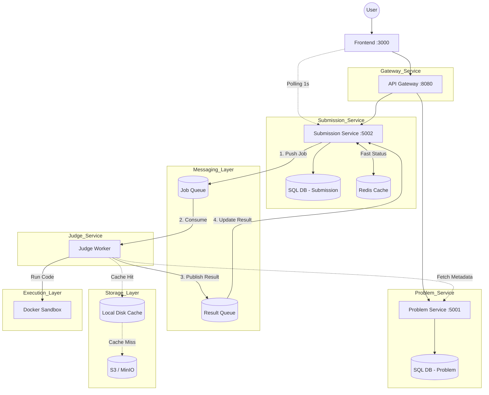

# System Architecture 

## 1. Pattern Selection
Dưới đây là các mô hình kiến trúc được lựa chọn để giải quyết các yêu cầu phi chức năng (Scalability, Reliability, Security):

| Pattern | Selected? | Business/Technical Justification |
|---------|-----------|----------------------------------|
| **API Gateway** | ✅ | Điểm truy cập duy nhất, quản lý Auth, Rate Limiting và ẩn cấu trúc microservices phía sau. |
| **Database per Service** | ✅ | Đảm bảo tính độc lập dữ liệu giữa Problem và Submission. Service này sập không ảnh hưởng đến dữ liệu service kia. |
| **Event-driven** | ✅ | Sử dụng RabbitMQ cho cả luồng nộp bài (Job Queue) và luồng trả kết quả (Result Queue) để đạt được sự mất liên kết (Decoupling) hoàn toàn. |
| **Bulkhead** | ✅ | Áp dụng tại Judge Service để giới hạn số lượng bài chấm đồng thời, bảo vệ máy chủ vật lý. |
| **Circuit Breaker** | ✅ | Bảo vệ Judge Service khỏi các sự cố khi gọi Problem Service lấy Metadata testcases. |
| **Service Discovery** | ✅ | Sử dụng Eureka Server (Spring Cloud Netflix) để đăng ký và khám phá dịch vụ động; các service gọi nhau qua service-id thay vì hardcode host/port. |
| **Local Disk Caching** | ✅ | Lưu trữ testcases ngay trên Worker Disk để tối ưu hiệu năng nạp dữ liệu (Shortcut cho Cache HIT). |
| **Idempotency** | ✅ | Đảm bảo tính toàn vẹn dữ liệu khi xử lý bản tin từ hàng đợi, ngăn chặn nộp bài 1 lần ra 2 kết quả. |
| **Saga Pattern** | ❌ | Không lựa chọn vì nghiệp vụ cập nhật trạng thái bài nộp đơn giản, sử dụng Eventual Consistency và Idempotency mang lại hiệu năng cao hơn gấp nhiều lần. |
| **Shared Database** | ❌ | Không lựa chọn để tránh sự phụ thuộc chặt chẽ giữa các dịch vụ (Tight Coupling) và cho phép scale dữ liệu độc lập. |
| **Sandbox Isolation** | ✅ | Thực thi mã nguồn người dùng trong Docker Container bị cô lập hoàn toàn tài nguyên và mạng. |
| **CQRS** | ❌ | Không lựa chọn vì mô hình đọc/ghi hiện tại còn đơn giản, áp dụng CQRS sẽ làm tăng độ phức tạp của mã nguồn không cần thiết. |

---

## 2. System Components

| Component     | Responsibility | Tech Stack      | Port  |
|---------------|----------------|-----------------|-------|
| **Frontend**  | Giao diện soạn thảo (Monaco) & Xem bài | React / Next.js | 3000 |
| **Gateway**   | Định tuyến, Xác thực JWT & Rate Limiting | Spring Boot + Spring Cloud Gateway | 8080 |
| **Service Discovery** | Đăng ký dịch vụ và tra cứu service instances | Spring Boot + Eureka Server | 8761 |
| **Problem Service**| Quản lý dữ liệu đề bài và các file testcases (.txt) | Java | 5001 |
| **Submission Service**  | Tiếp nhận bài nộp & Lắng nghe Result Queue | Java | 5002 |
| **Judge Service** | Worker lấy bài từ Queue & Chấm bài | Java / Docker| - |
| **Storage (S3)**| Lưu trữ tập trung các file Testcases văn bản thô | Minio / AWS S3 | 9000 |
| **RabbitMQ** | Hệ thống truyền tin bất đồng bộ (2 Queues) | RabbitMQ | 5672 |

---

## 3. Communication Matrix
*Cập nhật luồng giao tiếp giảm thiểu gọi trực tiếp giữa các Microservices.*

| From → To     | Problem Service | Submission Service | Judge Service | Gateway | Storage | MQ |
|---------------|-----------|-----------|---------|----------| --- | --- |
| **Frontend**  | ❌ (Qua GW) | ❌ (Qua GW) | ❌ | ✅ | ❌ | ❌ |
| **Gateway**   | ✅ (REST) | ✅ (REST) | ❌ | - | ❌ | ❌ |
| **Sub. Service**  | ✅ (REST) | - | ❌ | ❌ | ❌ | ✅ (Post/Listen) |
| **Judge Service** | ✅ (via CB) | ❌ | - | ❌ | ✅ (Download) | ✅ (Post/Listen) |

---

## 4. Architecture Diagram

---

## 5. Deployment

- All services containerized with Docker
- Orchestrated via Docker Compose
- Single command: `docker compose up --build`

---

## 6. Scalability & Fault Tolerance

### 6.1 How can individual services scale independently?
- **Judge Service:** Là thành phần tốn tài nguyên nhất (CPU-bound). Hệ thống cho phép mở rộng chiều ngang (Horizontal Scaling) bằng cách tăng số lượng instance Worker để tiêu thụ bản tin từ hàng đợi nhanh hơn khi có lượng bài nộp lớn.
- **API Services:** Problem và Submission Service được thiết kế Stateless, cho phép chạy song song nhiều bản sao đằng sau API Gateway để chia tải.
- **Storage & DB:** Việc tách biệt Database giúp cô lập tải trọng; các dịch vụ không cạnh tranh tài nguyên I/O với nhau.

### 6.2 What happens when a service goes down?
- **Isolation (Buffer):** Nếu Judge Service tạm dừng, Submission Service vẫn tiếp nhận bài nộp và lưu trữ an toàn trong Message Queue. Khi Judge Service "sống lại", nó sẽ xử lý nốt các công việc tồn đọng mà không làm mất dữ liệu của người dùng.
- **Cascading Failure Prevention:** Nhờ Circuit Breaker, nếu một dịch vụ cấp thấp (như Problem Service) sập, nó sẽ không kéo sập các dịch vụ cấp cao (Judge Service) thông qua hiện tượng nghẽn thread.

### 6.3 Are there retry mechanisms or circuit breakers?
- **Retry & DLQ:** Hệ thống áp dụng cơ chế thử lại tại hàng đợi. Những bản tin lỗi liên tục sẽ được đưa vào Dead Letter Queue để hậu kiểm, tránh việc làm tắc nghẽn luồng xử lý chính.
- **Resilience:** Circuit Breaker được tích hợp chặt chẽ trong luồng lấy Metadata giúp hệ thống luôn trong trạng thái "phản hồi nhanh" (Fail-fast) thay vì "chờ đợi vô vạn".

### 6.4 How is data consistency maintained across services?
- **Eventual Consistency:** Dữ liệu trạng thái bài nộp được cập nhật bất đồng bộ qua Queue. Hệ thống chấp nhận việc kết quả chưa hiển thị ngay lập tức (trong vài mili giây) để đổi lấy hiệu năng và tính sẵn sàng cao.
- **Idempotency:** Đảm bảo mỗi bản tin kết quả chấm điểm chỉ được ghi nhận một lần duy nhất vào Database, loại bỏ rủi ro sai lệch dữ liệu do truyền lặp.
