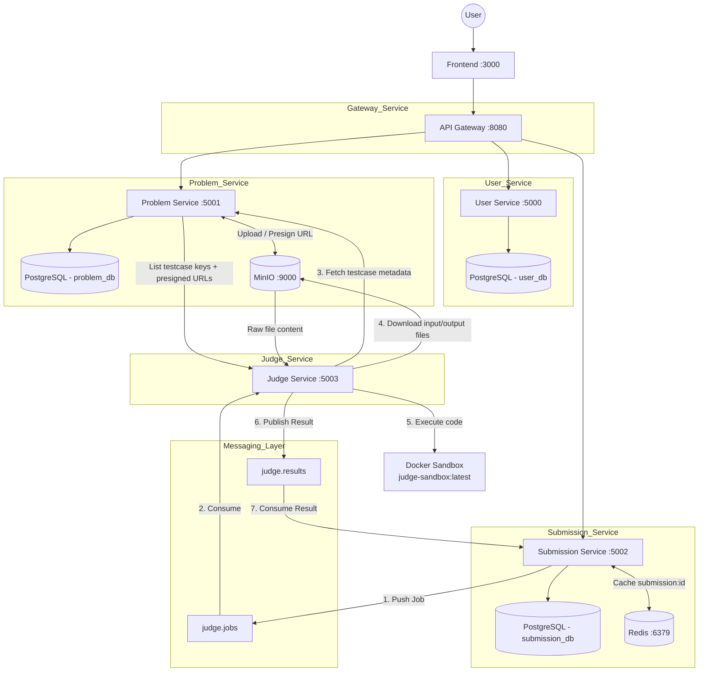

# System Architecture 

## 1. Pattern Selection
Dưới đây là các mô hình kiến trúc được lựa chọn để giải quyết các yêu cầu phi chức năng (Scalability, Reliability, Security):

| Pattern | Selected? | Business/Technical Justification |
|---------|-----------|----------------------------------|
| **API Gateway** | ✅ | Điểm truy cập duy nhất, quản lý Auth, Rate Limiting và ẩn cấu trúc microservices phía sau. |
| **Database per Service** | ✅ | Mỗi service có PostgreSQL riêng (`user_db`, `problem_db`, `submission_db`). Service này sập không ảnh hưởng dữ liệu service kia. |
| **Event-driven** | ✅ | Sử dụng RabbitMQ cho cả luồng nộp bài (Job Queue) và luồng trả kết quả (Result Queue) để đạt được sự mất liên kết (Decoupling) hoàn toàn. |
| **Circuit Breaker** | ✅ | Bảo vệ Judge Service khỏi các sự cố khi gọi Problem Service lấy Metadata testcases. |
| **Service Discovery** | ✅ | Sử dụng Eureka Server (Spring Cloud Netflix) để đăng ký và khám phá dịch vụ động; các service gọi nhau qua service-id thay vì hardcode host/port. |
| **Idempotency** | ✅ | Submission Service kiểm tra `status == FINISHED` trước khi ghi kết quả, ngăn chặn xử lý trùng lặp từ queue. 
| **Sandbox Isolation** | ✅ | Mã nguồn người dùng thực thi trong Docker Container (`judge-sandbox` image) cô lập hoàn toàn tài nguyên và mạng. ||
| **Saga Pattern** | ❌ | Không lựa chọn vì nghiệp vụ cập nhật trạng thái bài nộp đơn giản, sử dụng Eventual Consistency và Idempotency mang lại hiệu năng cao hơn gấp nhiều lần. |
| **Shared Database** | ❌ | Không lựa chọn để tránh sự phụ thuộc chặt chẽ giữa các dịch vụ (Tight Coupling) và cho phép scale dữ liệu độc lập. |
| **Sandbox Isolation** | ✅ | Thực thi mã nguồn người dùng trong Docker Container bị cô lập hoàn toàn tài nguyên và mạng. |
| **CQRS** | ❌ | Không lựa chọn vì mô hình đọc/ghi hiện tại còn đơn giản, áp dụng CQRS sẽ làm tăng độ phức tạp của mã nguồn không cần thiết. |

---

## 2. System Components

| Component | Trách nhiệm | Tech Stack | Port |
|-----------|-------------|------------|------|
| **Frontend** | Giao diện soạn thảo (Monaco Editor), xem bài, lịch sử nộp | React 18 + TypeScript + Vite + Tailwind CSS | 3000 |
| **API Gateway** | Định tuyến, xác thực JWT, Rate Limiting | Spring Boot + Spring Cloud Gateway | 8080 |
| **Service Discovery** | Đăng ký & khám phá dịch vụ | Spring Boot + Eureka Server | 8761 |
| **User Service** | Quản lý tài khoản, cấp phát token | Java / Spring Boot | 5000 |
| **Problem Service** | Quản lý đề bài, testcases, metadata | Java / Spring Boot | 5001 |
| **Submission Service** | Tiếp nhận bài nộp, lắng nghe Result Queue | Java / Spring Boot | 5002 |
| **Judge Service** | Worker chấm bài, quản lý Docker Sandbox | Java / Spring Boot | 5003 |
| **RabbitMQ** | Message Broker — 2 queues: Jobs & Results | RabbitMQ 3 | 5672 / 15672 |
| **Redis** | Cache trạng thái bài nộp (Polling optimization) | Redis 7 | 6379 |
| **MinIO** | Object Storage lưu trữ file testcases (.txt) | MinIO | 9000 / 9001 |
| **PostgreSQL** | Database riêng biệt cho từng service | PostgreSQL 16 | 5433–5435 |
| **Prometheus** | Thu thập metrics hệ thống | Prometheus | 9090 |
| **Grafana** | Dashboard giám sát & cảnh báo | Grafana | 3001 |
| **Loki + Promtail** | Tập trung logs từ tất cả container | Grafana Loki | 3100 |
---

## 3. Communication Matrix
*Cập nhật luồng giao tiếp giảm thiểu gọi trực tiếp giữa các Microservices.*

| From → To | User Service | Problem Service | Submission Service | Judge Service | MinIO | RabbitMQ |
|-----------|-------------|-----------------|-------------------|---------------|-------|----------|
| **Frontend** | ❌ (qua GW) | ❌ (qua GW) | ❌ (qua GW) | ❌ | ❌ | ❌ |
| **API Gateway** | ✅ REST | ✅ REST | ✅ REST | ❌ | ❌ | ❌ |
| **Submission Service** | ❌ | ❌ | - | ❌ | ❌ | ✅ Publish/Consume |
| **Judge Service** | ❌ | ✅ REST (Circuit Breaker) | ❌ | - | ✅ Download | ✅ Publish/Consume |
| **Problem Service** | ❌ | - | ❌ | ❌ | ✅ Upload/Presign | ❌ |

---

## 4. Architecture Diagram

---

## 5. Deployment

- Tất cả services được containerize bằng Docker
- Orchestrate bằng Docker Compose (`docker-compose.yml`)
- Khởi động toàn bộ hệ thống: `docker compose up --build`
- Sandbox image build riêng: `docker compose --profile build-sandbox build`
- Judge Service mount `/var/run/docker.sock` để spawn sandbox container

---

## 6. Scalability & Fault Tolerance

### 6.1 How can individual services scale independently?
- **Judge Service:** CPU-bound, scale horizontal bằng cách tăng số instance worker. RabbitMQ `prefetch=1` đảm bảo load được phân phối đều giữa các worker.
- **Submission / Problem / User Service:** Stateless, có thể chạy nhiều bản sao song song đằng sau API Gateway. Eureka tự động load balance.
- **Database:** Mỗi service có DB riêng, không cạnh tranh I/O với nhau.

### 6.2 What happens when a service goes down?
- **Judge Service down:** Submission Service vẫn tiếp nhận bài nộp, job được giữ an toàn trong `judge.jobs` queue. Khi Judge Service khởi động lại, xử lý tiếp tồn đọng.
- **Problem Service down:** Circuit Breaker tại Judge Service chuyển sang OPEN, trả về `SE` verdict thay vì chờ vô hạn (fail-fast).
- **Redis down:** Submission Service fallback về query trực tiếp PostgreSQL.

### 6.3 Are there retry mechanisms or circuit breakers?
- Judge Service retry 3 cấp với TTL tăng dần (30s → 2m → 10m) trước khi đưa vào `judge.jobs.dlq`.
- Submission Service retry tối đa 3 lần với exponential backoff (3s, 6s, 12s) khi consume `judge.results`.
- DLQ cho phép hậu kiểm và replay thủ công các job thất bại.

### 6.4 How is data consistency maintained across services?
- **Eventual Consistency:** Kết quả bài nộp được cập nhật bất đồng bộ qua queue. Client polling mỗi 1-2 giây để nhận kết quả cuối cùng.
- **Idempotency:** `SubmissionListener` kiểm tra `status == FINISHED` trước khi ghi — đảm bảo mỗi kết quả chỉ được ghi một lần dù message được deliver nhiều lần.
